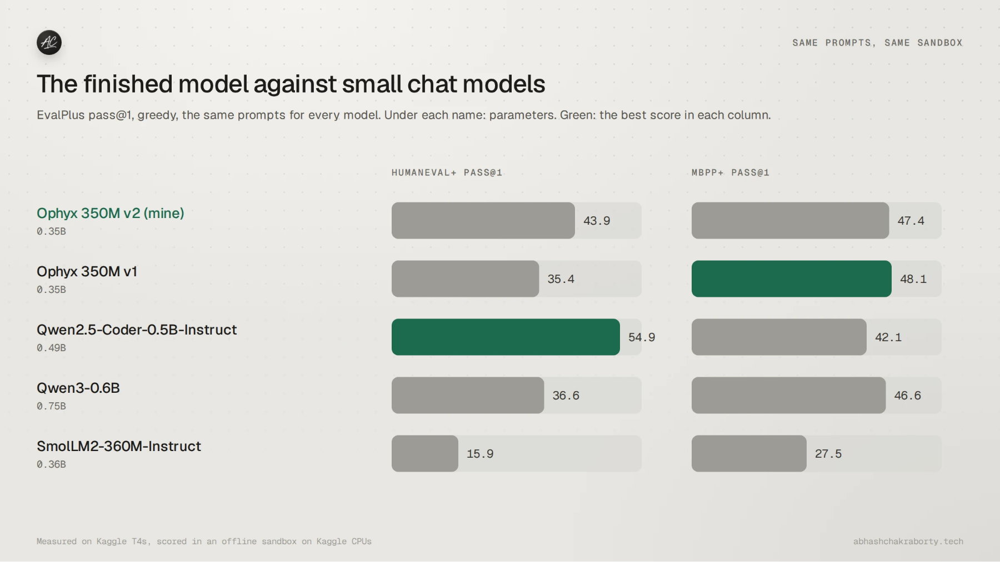
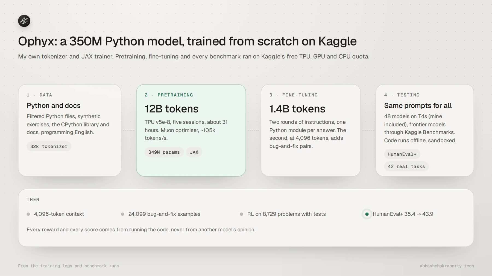

# Ophyx

<p align="center">
  <a href="https://huggingface.co/abhash-chakraborty/ophyx-350m-v2"><picture>
    <source media="(prefers-color-scheme: dark)" srcset="https://shieldcn.dev/badge/Hugging%20Face-ophyx--350m--v2-ffd21e.svg?logo=huggingface&variant=secondary&mode=dark" />
    
  </picture></a>
  <a href="eval/R1_RESULTS.md"><picture>
    <source media="(prefers-color-scheme: dark)" srcset="https://shieldcn.dev/badge/HumanEval%2B-43.9-1e6b4f.svg?variant=secondary&mode=dark" />
    
  </picture></a>
  <a href="https://github.com/Abhash-Chakraborty/ophyx/actions/workflows/ci.yml"><picture>
    <source media="(prefers-color-scheme: dark)" srcset="https://shieldcn.dev/github/ci/Abhash-Chakraborty/ophyx.svg?workflow=ci&variant=secondary&mode=dark" />
    
  </picture></a>
  <a href="LICENSE"><picture>
    <source media="(prefers-color-scheme: dark)" srcset="https://shieldcn.dev/badge/licence-Apache--2.0-blue.svg?variant=secondary&mode=dark" />
    
  </picture></a>
</p>

A 350M-parameter Python code model, trained from scratch on Kaggle's free TPU, GPU and CPU quota.
The finished model, [ophyx-350m-v2](https://huggingface.co/abhash-chakraborty/ophyx-350m-v2),
scores 43.9 on HumanEval+. This repo holds everything that made it: the data jobs, a JAX trainer,
fine-tuning, reinforcement learning and the benchmark harness.



## Use the model

```python
from transformers import AutoModelForCausalLM, AutoTokenizer

repo = "abhash-chakraborty/ophyx-350m-v2"
tok = AutoTokenizer.from_pretrained(repo)
model = AutoModelForCausalLM.from_pretrained(repo).eval()

prompt = "Write a function `is_palindrome(s)` that ignores case and non-letters."
ids = tok(f"<|user|>\n{prompt}\n<|python|>\n", return_tensors="pt", add_special_tokens=False).input_ids
end = tok.convert_tokens_to_ids("<|end|>")
out = model.generate(ids, max_new_tokens=256, do_sample=False, eos_token_id=end, pad_token_id=end)
print(tok.decode(out[0, ids.shape[1]:], skip_special_tokens=True))
```

GGUF files for llama.cpp (f32, f16 and q8_0) are in
[ophyx-350m-v2-gguf](https://huggingface.co/abhash-chakraborty/ophyx-350m-v2-gguf).

## How it was built



| Stage | What | Hardware | HumanEval+ after |
|---|---|---|---|
| Pretraining | 12B tokens at 2,048 context, Muon optimiser | TPU v5e-8, five sessions, about 31 h | 31.7 |
| Longer context | 2B more tokens at 4,096 | TPU v5e-8, 11.7 h | 28.0 |
| SFT v1 | 600M tokens at 2,048: one Python module per answer | TPU v5e-8 | 35.4 |
| SFT v2 | 800M tokens at 4,096, adding problem-bank answers and bug-and-fix rows | TPU v5e-8, 4.7 h | 37.8 |
| Averaging | 70% SFT v2 plus 30% SFT v1, weight by weight | Kaggle CPU | 41.5 |
| GRPO | One pass over 1,399 problems; the only reward is passing their tests | one T4, 5.4 h | **43.9** |

The 4,096-token run lost ground on short tasks: it rambled, and nearly three times as many MBPP answers
hit the length limit (51 against 19). Averaging the long-context fine-tune with the short one won that back, and RL took it
further. A DPO pilot and an earlier GRPO round stayed within noise, so they didn't ship. The
details of every run are in [eval/R1_RESULTS.md](eval/R1_RESULTS.md).

The architecture is Qwen3's layout, so standard tools load it: 28 layers, hidden size 1,024, 16
query and 4 key-value heads, a 32,768-token vocabulary trained on the data mix, and RoPE base
100,000. The trainer (`train/pretrain.py`) is my own JAX loop and exports straight to Hugging Face
format.

## Results

Pass@1 in percent, greedy. Every open model ran through the same harness on Kaggle T4s, and every
answer ran in the same offline sandbox.

| Model | Params | HumanEval+ | MBPP+ | BCB-Hard instruct | LiveCodeBench | CRUX-O | Hands-on (of 42) |
|---|---|---|---|---|---|---|---|
| **Ophyx 350M v2** | 0.35B | **43.9** | 47.4 | 4.6 | 2.0 | 21.9 | 9 |
| Ophyx 350M v1 | 0.35B | 35.4 | 48.1 | 3.8 | 1.5 | 19.5 | 10 |
| SmolLM2-360M-Instruct | 0.36B | 15.9 | 27.5 | 0.0 | 0.9 | 20.4 | 3 |
| Qwen2.5-Coder-0.5B-Instruct | 0.49B | 54.9 | 42.1 | 2.3 | 0.6 | 25.1 | 4 |
| Qwen3-0.6B | 0.75B | 36.6 | 46.6 | 0.8 | 7.9 | 24.8 | 5 |
| deepseek-coder-1.3b-instruct | 1.35B | 61.6 | 52.6 | 3.8 | 5.6 | 28.8 | 13 |

- [eval/R1_RESULTS.md](eval/R1_RESULTS.md): 48 models from 0.13B to 4B, frontier
  models through Kaggle Benchmarks, and published leaderboard scores with sources.
- [eval/HANDS_ON_REVIEW.md](eval/HANDS_ON_REVIEW.md): all 42 hands-on answers read by hand, and
  why 33 of them fail.

## Running untrusted code

Benchmarks, the problem bank and the RL reward all run code a model wrote. That code only ever runs
in a Kaggle session with internet off and no keys attached, in a child process with a wall-clock
timeout, `prlimit` CPU, memory and file limits, an empty environment and its own temp dir. Sessions
that need a token (uploads, downloads of private repos) run no generated code. Models and wheels
reach the offline sessions through `data/jobs/relay_in.py`.

## Repository layout

| Path | What's in it |
|---|---|
| `data/jobs/` | Kaggle jobs: ingest and filter, dedup and decontaminate, tokenise, problem bank, bug injection, SFT sets, bank sampling and judging |
| `data/synth/`, `data/own/`, `data/github/` | Synthetic exercises and their offline verifier, 85 hand-written problems, GitHub repo discovery |
| `train/` | `pretrain.py` (JAX, TPU), `dpo_t4.py`, `grpo_t4.py`, `average_ckpt.py`, `export_ckpt.py`, `export_gguf.py` |
| `eval/` | `bench_kit.py`, `bench_gen.py`, `bench_exec.py`, `bench_report.py`, the concept suite, the hands-on set and the results |
| `kaggle/` | `launch.py` (push any script as a Kaggle kernel), `watchdog.py` and `chains/` (multi-session training), tools |
| `serve/` | A Modal endpoint for a demo: scales to zero, rate-limited per IP |
| `docs/` | [The plan](docs/plan.md), [the data](docs/data.md), [the training regime](docs/training.md) and [how to reproduce it](docs/reproduce.md) |
| `tests/` | CPU tests for the scoring helpers, averaging, the launcher and the task sets |

## Develop

```bash
uv run --with pytest --with numpy --with safetensors --with pandas --with requests pytest
uvx ruff check .
```

The tests need no GPU and no network. One of them runs every hands-on reference solution in the
scoring sandbox, so it needs `prlimit` (util-linux) and takes about ten seconds.

Most scripts run as Kaggle kernels rather than locally. [docs/reproduce.md](docs/reproduce.md)
walks through the accounts, keys and commands for each stage.

## Environment

| Variable | Used by | What for |
|---|---|---|
| `KAGGLE_API_TOKEN` | `kaggle/launch.py`, `kaggle/watchdog.py` | Pushing and polling Kaggle kernels |
| `KAGGLE_USERNAME` | same | Your Kaggle user, if it isn't the author's |
| `HF_TOKEN` | upload jobs, the watchdog, the Modal secret | Reading and writing private Hugging Face repos |
| `NTFY_TOPIC` | `kaggle/watchdog.py` | Phone notifications when a training chain stops |
| `OPHYX_CONFIG` | every job script | A job's CONFIG when run outside `launch.py` |
| `OPHYX_MODEL`, `OPHYX_GPU`, `OPHYX_ORIGINS` | `serve/modal_app.py` | Model repo, GPU type and allowed origins for the demo |

Keep them in a `.env` at the repo root (it's ignored by git). Inside Kaggle, a private dataset holds
`keys.json` with the HF token and is attached only to sessions that run no generated code.

## Status

Training is finished and the model is released. The hourly watchdog is switched off and every chain
in `kaggle/chains/` is disabled.

- The tokenised training data and the intermediate checkpoints live in private Hugging Face repos.
  The jobs that build them are all here.
- Some Kaggle datasets and kernels keep the project's earlier name, `pycoder-*`, because Kaggle
  can't rename them.
- The model is weak at what the hands-on set measures: it adds its own tests to answers, often
  returns quiet bugs unfixed, and misses details in long prompts. See the
  [hands-on review](eval/HANDS_ON_REVIEW.md).

## Licence

Code and model weights: [Apache-2.0](LICENSE). Benchmarks and public datasets are downloaded at run
time and keep their own licences.
